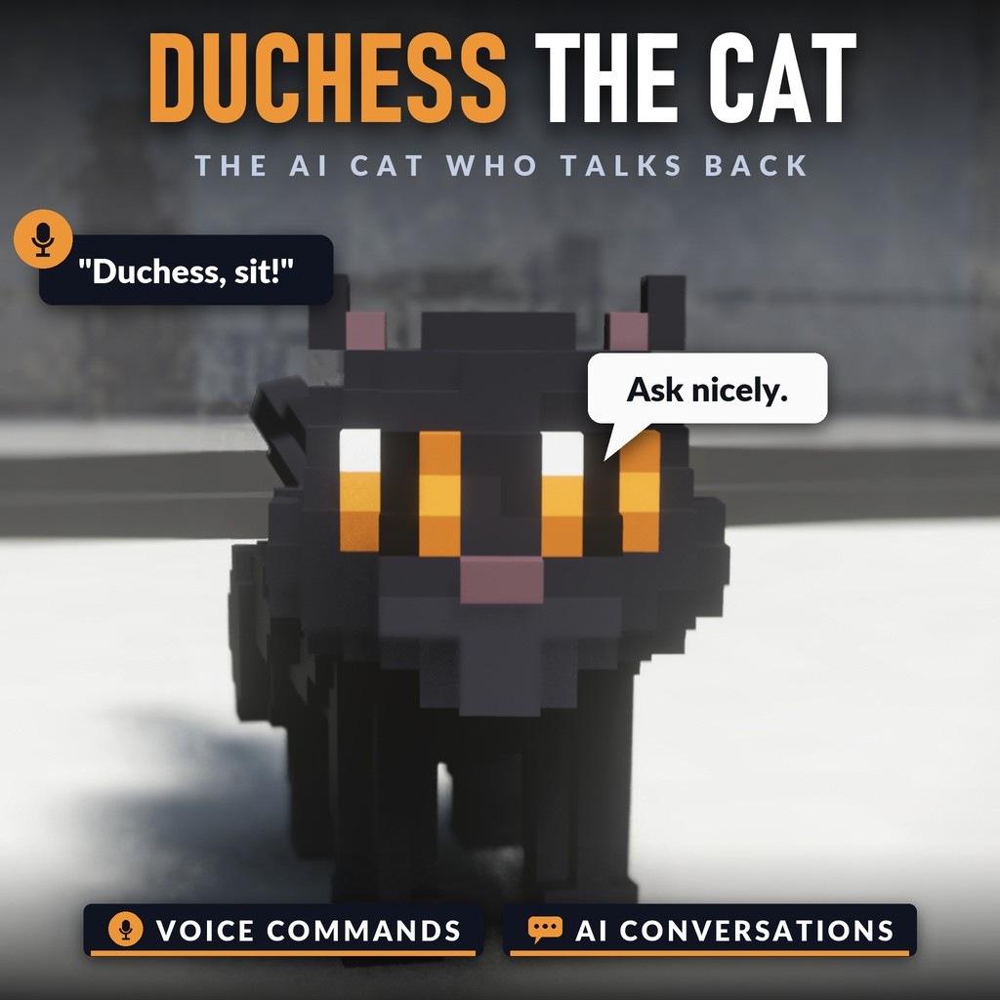

# Duchess the Cat - the AI cat who talks back

On the Steam Workshop: [Duchess the Cat](https://steamcommunity.com/sharedfiles/filedetails/?id=3833506307)

A plump black British Shorthair joins you in any level. Talk to her out loud or in the chat, and she **answers you** - if she feels like it. Posh, dry, sarcastic, and secretly fond of you (she would never admit it). You are her staff.

## 🎤 Voice commands
- Just say it: *"Duchess, sit!"*, *"come here"*, *"follow me"*, *"stay"*, *"take a nap"*, *"get up on the crate"*, *"roll over"*...
- She understands normal sentences, not just keywords - and she decides whether you deserve it. Ask nicely.
- Speak with your microphone (speech to text through Koetama) or type in the chat - both work.

## 💬 AI conversations
- Ask her anything. She answers in character, in a sentence or two, and a *"Hmph."* is often all you get.
- Ask her to do something and she decides like a cat: often no, sometimes slowly, more readily if you ask nicely - or bribe her.
- She knows what's going on: who's near her, her health, that you just fed her, petted her too much or woke her up.
- Her replies are speech bubbles over her head with a babble voice, heard by everyone nearby, like any player's.

## 🐾 A real cat
- **Her own business** - naps curled up, loafs, grooms, leaps up onto ledges and crates, gets the zoomies, knocks small things over while looking at you, stares, rubs against your legs, demands food.
- **Laser pointer** - shine the red dot (tools, key 6) and she can't resist it: she chases it and pounces.
- **Fish treats** - toss one (tools, key 6). She also steals Mochi's biscuits.
- **Petting** - look at her and press **E**. She purrs... until she's had enough, and then you get scratched. A belly shown is a trap.
- **Water** - she hates it. Fall in and she swims for dry land, climbs out and shakes off, deeply offended.
- **Nine lives** - hurt her and she bolts. She comes back after a while, as if nothing happened.

## Other AI characters
She hears other AI characters too and talks with them. With [Mochi the Corgi](https://steamcommunity.com/sharedfiles/filedetails/?id=3826771785) on, she teases him, stalks him and hisses when he crowds her.

## Requirements
- [Proximity Comms (Text and Voice Chat)](https://steamcommunity.com/sharedfiles/filedetails/?id=3812301496) - turn it on as well: Duchess hears and speaks through it.
- **For AI conversations**, the **host** runs the free [Koetama](https://github.com/AgeOfAlgorithms/koetama) app with a language model set up (your own API key - OpenAI, Anthropic, DeepSeek, Gemini... - or a local model) and allowed for Teardown. Other players need nothing for that.
- **For voice**, whoever speaks needs Koetama for speech to text. Typing works for everyone.
- Without an AI she still (sometimes) does what she's told - she's a cat.

## Multiplayer
The host turns on Duchess and Proximity Comms under Global mods. Everyone sees the same cat; anyone nearby can talk to her.

## AI notice
Duchess's replies are written live by an AI model. What players say near her is sent to the AI service the host chose in Koetama, and the host pays for it (Koetama has a monthly budget limit). Players should know this before they chat near her.

## Controls
- **Talk** - **Enter** to type to her in the chat, or just speak if you use Koetama
- **E** - look at Duchess to pet her
- **6** - your cat tools: **Fish treats** (8, one more every 20 s; **left click** tosses one) and the **Laser pointer** (**hold left click**)

## Community

Join the [Discord community](https://discord.gg/gNpRewdkxf) to post bug reports and suggestions.

## Install

Subscribe on the [Steam Workshop](https://steamcommunity.com/sharedfiles/filedetails/?id=3833506307), or clone this repository into
`Documents/Teardown/mods/pudding the cat`. Enable it under **Global mods** (in multiplayer the host does).

## Credits

Made by AgeOfAlgorithms and Claude (Anthropic). MIT licence.
